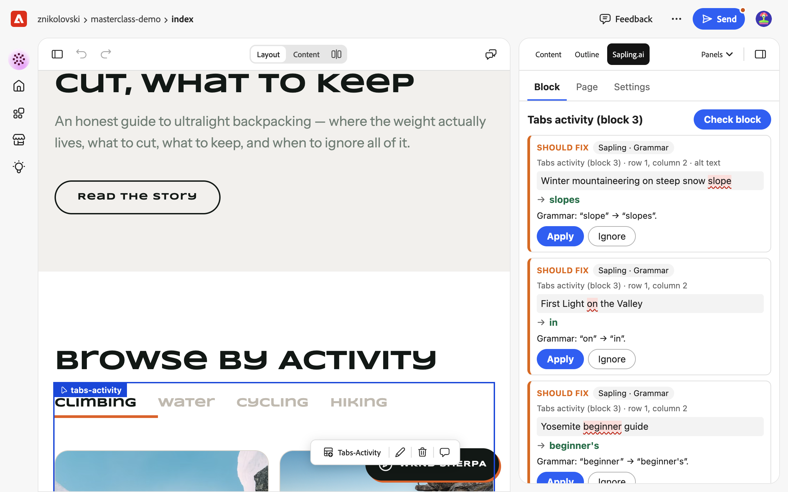
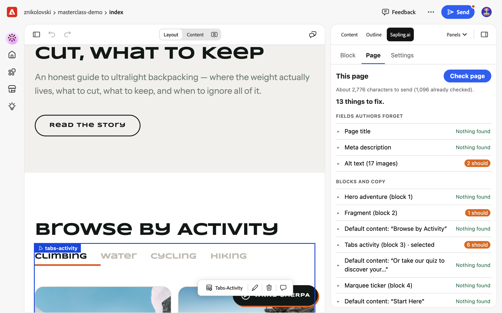
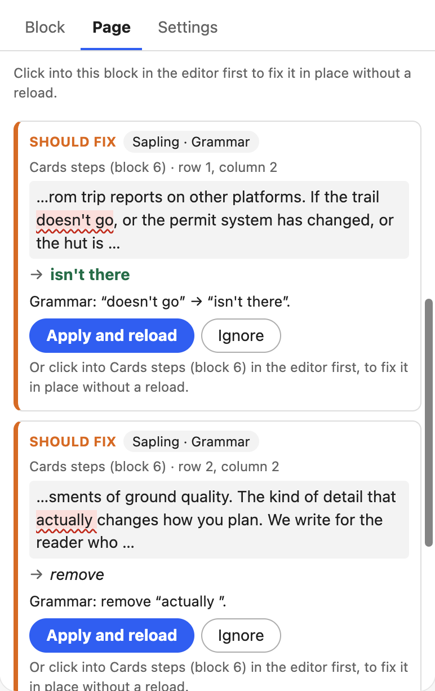
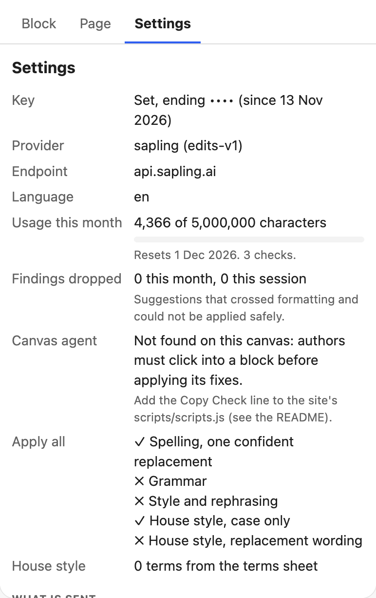

# Copy Check

Copy Check is a panel for [Experience Workspace](https://da.live) that checks the copy in the selected block or the whole page, and fixes it in place. Spelling and grammar come from [Sapling](https://sapling.ai). House style comes from a terms sheet in the site config. Built-in checks cover alt text, link text and the meta description.



## What authors see

**Block view.** Place the cursor in a block and click **Check block**. Each finding names its cell, marks the words, shows the suggestion and its source (Sapling, house style or a built-in check). **Apply** writes the fix into the block, and undo works as usual. Nothing is checked as you type.

**Page view.** **Check page** covers every block, all default content, the page title, the meta description and alt text. Findings are counted by severity (must, should, consider), never as a score. The view shows how many characters a check will send, and ends with a prompt to send the page for a governance check. Copy Check never blocks publishing.



| A finding in another block | Settings (administrators) |
| --- | --- |
|  |  |

**Apply** on a finding in another block selects that block for the author, then fixes it in place. This needs the canvas agent (setup step 3). Without it, as on the site above, the button reads **Apply and reload**, and clicking into the block first still fixes it in place.

## Setup

### 1. Deploy (optional)

Sites can use the shared deployment at `https://28538-copycheck.adobeio-static.net` and skip to step 2. To run your own:

```sh
cd broker
cp .env.example .env            # set COPYCHECK_ENCRYPTION_KEY
npm install
aio login && aio app use        # select the org, project and workspace
aio app deploy
```

One App Builder app serves both parts, for every site:

- The plugin: `https://{namespace}.adobeio-static.net/copy-check.html`
- The broker API: `https://{namespace}.adobeio-static.net/api/v1/web/copy-check/api`

The broker holds the Sapling key, so the browser never sees it. The build writes the broker URL into the plugin page, so the plugin only sends the author's token to the broker it was deployed with.

| Setting | Where | Purpose |
| --- | --- | --- |
| `COPYCHECK_ENCRYPTION_KEY` | `.env` (required) | 32 random bytes, base64. Encrypts each site's Sapling key. Changing it makes stored keys unreadable, so admins must set them again. |
| `ALLOWED_ENDPOINT_HOSTS` | `app.config.yaml` | Sapling hosts the broker may call, for example a self-hosted one. |
| `DEFAULT_MONTHLY_BUDGET`, `MAX_MONTHLY_BUDGET` | `app.config.yaml` | Characters per site per month when the site sets none, and a ceiling no site can exceed. |
| `USER_REQUESTS_PER_MINUTE`, `USER_CHARS_PER_MINUTE` | `app.config.yaml` | Per-user rate limit. |

### 2. Add the panel to the site config

Open `https://da.live/config#/{org}/{site}/`. Add a row to the **library** sheet:

| title | path | experience |
| --- | --- | --- |
| Copy Check | `https://28538-copycheck.adobeio-static.net/copy-check.html` | dialog |

Optional settings go in the **data** sheet:

| key | example | purpose |
| --- | --- | --- |
| `copycheck.language` | `en-AU` | Language and regional spelling. |
| `copycheck.budget` | `5000000` | Characters a month. Match the spend alert in the Sapling account. |
| `copycheck.applyall` | `spelling, term-case` | What **Apply all safe fixes** may change: `spelling`, `grammar`, `style`, `term-case`, `term-wording`. |
| `copycheck.skipblocks` | `product-specs, embed` | Blocks whose text another system owns. Never sent or changed. |
| `copycheck.protect` | `\b[A-Z]{3}-\d{4}\b` | A pattern for product codes and similar. Never sent or changed. |
| `copycheck.endpoint` | `https://api.sapling.ai` | A self-hosted Sapling, if allowed by the broker. |
| `copycheck.governance` | `Run a governance check on {path}` | The prompt placed in chat at the end of the page view. |

House style goes in a **terms** sheet:

| term | type | replacement | note |
| --- | --- | --- | --- |
| AEM | use carefully | Adobe Experience Manager | Spell out on first use |
| best in class | do not use | | Not an approved claim |
| Edge Delivery Services | approved | | Capitalise all three words |

`approved` flags any other casing or spacing. `do not use` flags every use. `use carefully` flags the first use on the page, unless the replacement appears earlier. The note is shown to the author.

### 3. Let Copy Check select blocks (recommended)

Add this line to the site's `scripts/scripts.js`, outside any function, and commit it to `main`:

```js
if (window.top !== window) import('https://28538-copycheck.adobeio-static.net/agent.js').catch(() => {});
```

The script loads only inside a frame such as the Experience Workspace canvas, so site visitors never load it. It changes nothing on the page. When the author applies a fix in another block, it presses on that block in the canvas, as the author would, and the editor selects it. It answers only the Copy Check panel in the same tab, for the same site. **Settings** shows whether it is connected.

### 4. Set the Sapling key

Create an API key at sapling.ai, ideally with a service account. A site administrator (anyone who can edit the site config) pastes it into **Settings**. The broker checks the key with one short request before replacing the old one, then stores it encrypted for that site only. The panel shows only its last four characters.

## How fixes are applied

- **In a block:** the panel rebuilds the block with the fix and asks the editor to replace it. The editor refuses if the page or the selection changed since the check, so a fix never lands on edited text. One fix is one undo step.
- **Default content and metadata:** the editor can only guard replacements inside a block. So the panel saves the page, writes the fix to the saved page only if nobody else changed it in the meantime, and the editor reloads. Undo is through the page's version history.
- **Apply all safe fixes** shows every change first. With the canvas agent, it fixes each block in place and writes the rest in one save. Without it, everything goes in one save.
- A suggestion that spans formatting (for example half a bold word) is dropped rather than guessed. If the same text appears twice and has moved since the check, the fix is skipped rather than applied to the wrong copy.

## Privacy and cost

- Only the text being checked is sent to Sapling. No page path, block names or author identity are sent. URLs, email addresses and protected values are masked first.
- Each piece of text is sent once. Results are cached in the browser and per site in the broker, so unchanged text costs nothing to check again.
- The broker enforces the monthly character budget per site and a per-user rate limit. When the budget is spent it stops, and says when it resets. Two checks that start at the same moment can exceed the budget by at most one request (60,000 characters).
- House style and built-in checks run in the browser and send nothing. They keep working when Sapling is unavailable, and cached Sapling findings are shown with their age.

## Development

```sh
npm install && (cd broker && npm install)
npm run dev          # mock Experience Workspace, DA and Sapling on :3400 and :3401
npm run dev:broker   # the broker action on :8790, with in-memory storage
```

Open `http://127.0.0.1:3400/dev/host.html` and set the key `dev-sapling-key-1234` in **Settings**. Add `?as=author` for a non-admin, `?agent=0` for a site without the canvas agent, or `?legacy=1` for an editor without in-place replace.

The mock host speaks the same protocol as Experience Workspace and logs every message. Below the editor, a mock canvas loads the agent as a site would. The host, plugin and canvas run on `127.0.0.1`, `localhost` and `[::1]`, so they are cross-site, as in Experience Workspace.

```sh
npm test               # plugin and broker tests
```

| Path | Contents |
| --- | --- |
| `plugin/tools/copy-check/` | The plugin, its canvas agent and bridge. Plain ES modules, no build step. |
| `broker/` | The App Builder app: the `copy-check/api` action, and the hook that publishes the plugin. |
| `dev/` | Mock Experience Workspace host, canvas, DA Admin and Sapling. |

## Limitations

- Default content and metadata fixes reload the editor.
- Selecting a block for the author needs the agent line in the site's `scripts.js`.
- One language per site. Pages that mix languages are checked in the site's language.
- Sapling is the only engine. Others can be added in `broker/lib/providers/`.
